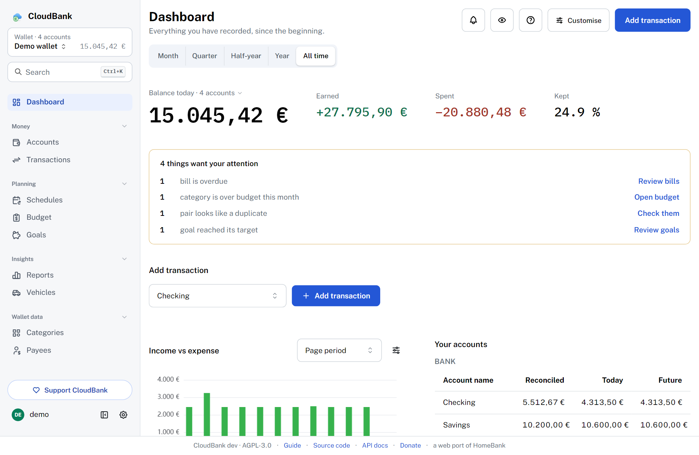
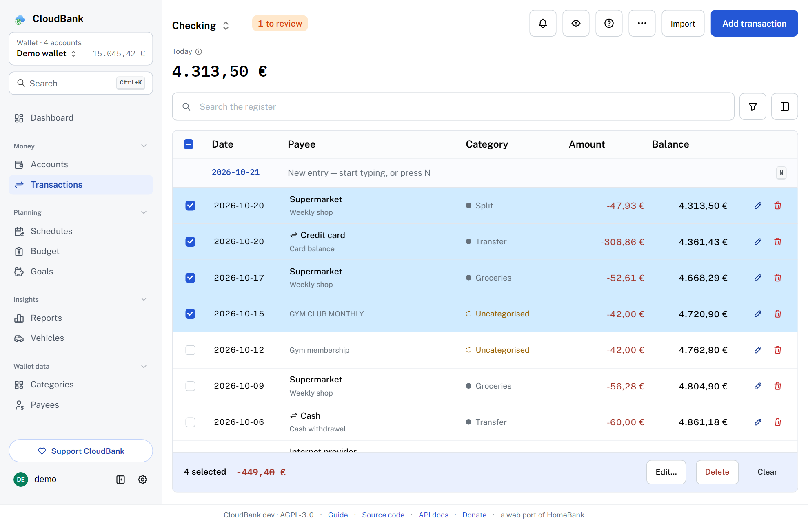
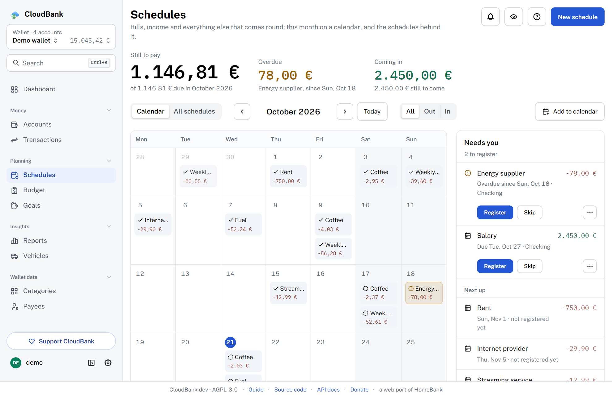
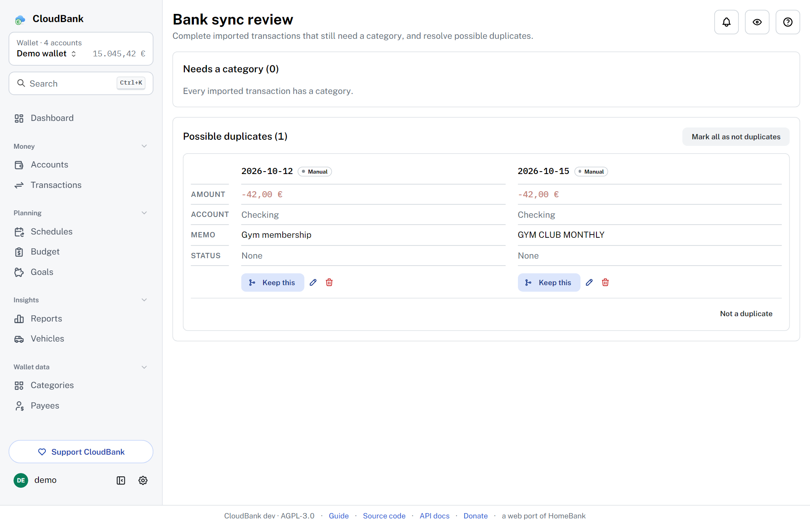
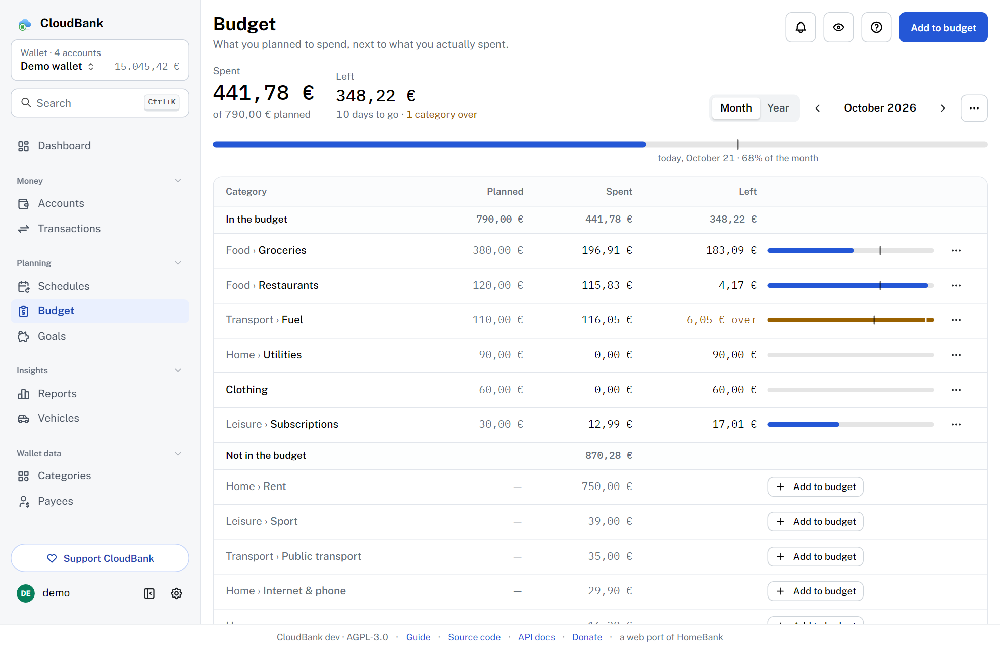
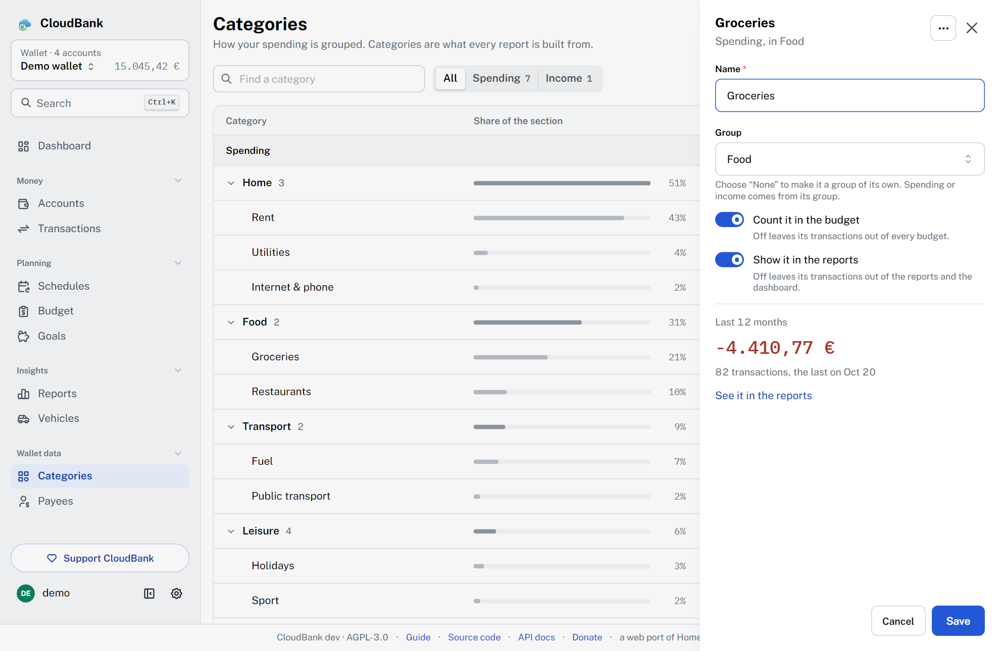
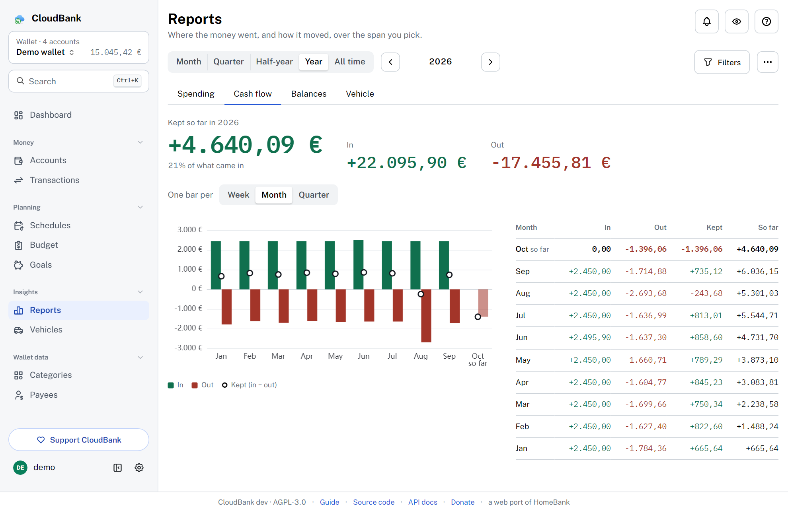
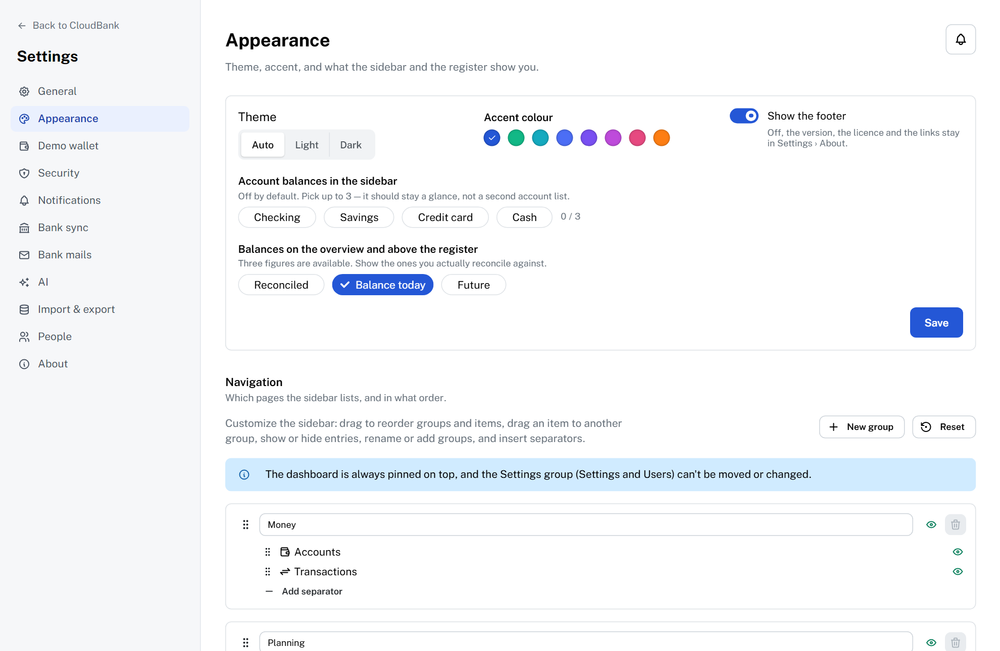
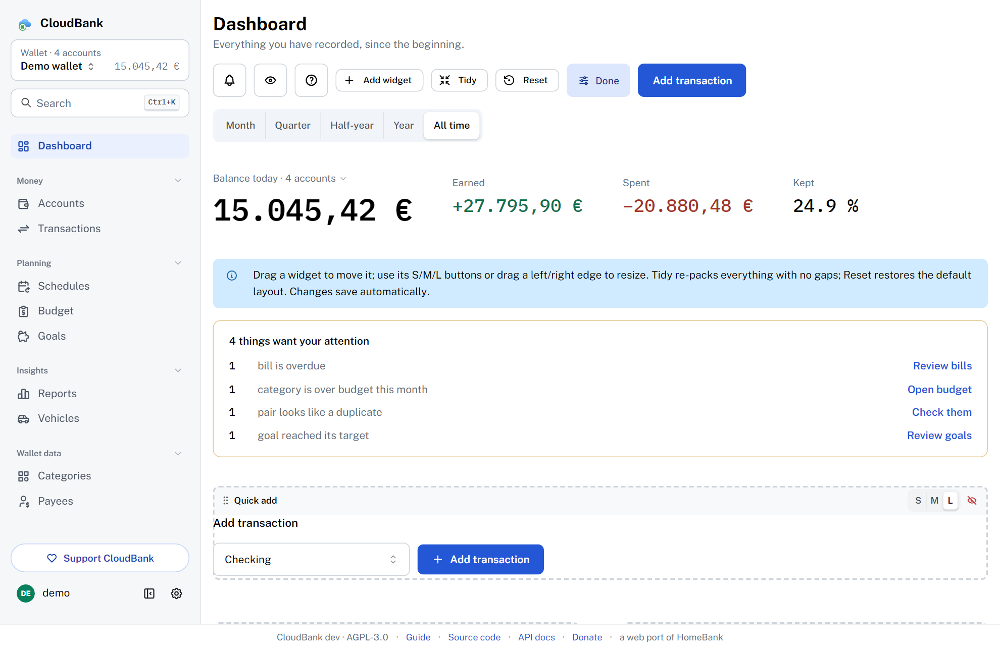
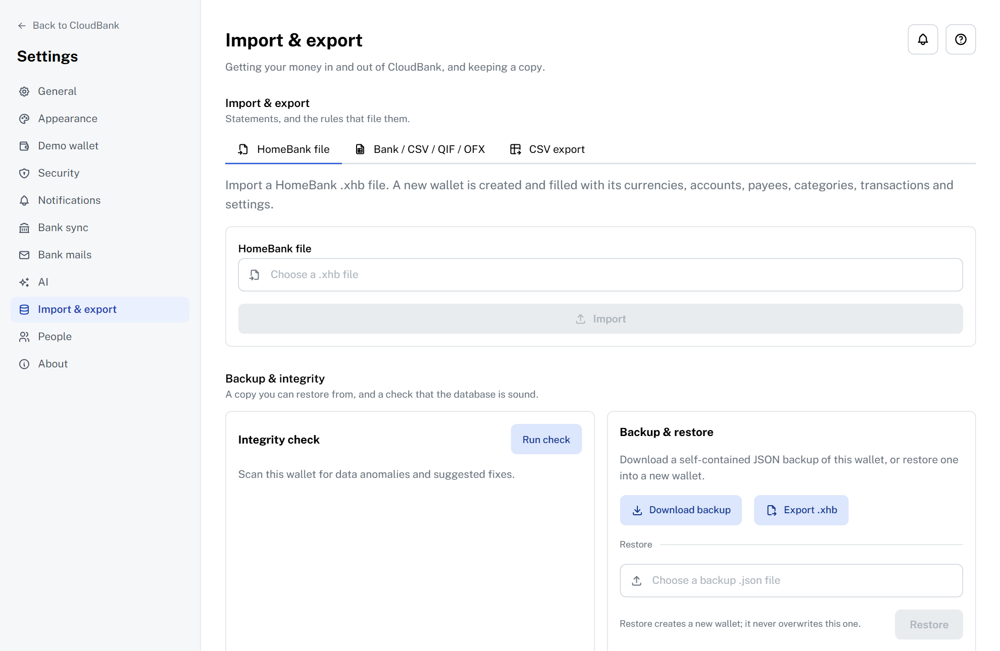

<p align="center">
  
</p>

<h1 align="center">CloudBank</h1>

<p align="center">
  <strong>Dein Geld, auf deinem Server.</strong><br />
  Eine kostenlose Finanzverwaltung im Web: eine von Grund auf neu geschriebene Browser-Version von <a href="https://www.gethomebank.org/">HomeBank</a>.
</p>

<p align="center">
  <a href="README.md">English</a> · <a href="README.it.md">Italiano</a> · <strong>Deutsch</strong> · <a href="README.fr.md">Français</a> · <a href="README.es.md">Español</a> · <a href="README.pt-BR.md">Português (Brasil)</a>
</p>

<p align="center">
  <a href="https://p01--cloudbank--7dcjw6mlmtky.code.run/"></a>
</p>

<p align="center">
  <sub>Ausgedachte Daten in einem Wegwerf-Konto, das gelöscht wird, wenn du es nicht mehr nutzt. <a href="docs/demo.md">Was die Demo ist</a> (auf Englisch).</sub>
</p>

<p align="center">
  <a href="https://github.com/easly1989/cloudbank/actions/workflows/ci.yml"></a>
  <a href="https://github.com/easly1989/cloudbank/issues"></a>
  <a href="https://github.com/easly1989/cloudbank/pkgs/container/cloudbank"></a>
  <a href="LICENSE"></a>
</p>

---

**CloudBank** ist eine kostenlose Finanzverwaltung zum Selbsthosten, die du im Browser nutzt: eine von Grund auf neu geschriebene Web-Portierung der hervorragenden Desktop-App [HomeBank](https://www.gethomebank.org/). Sie will alles können, was HomeBank kann, aber für den Browser gedacht: ein einziger Docker-Container, den du selbst betreibst, mit den Daten in einer SQLite-Datenbank auf einem Volume, das du kontrollierst.

**Probier es zuerst aus:** Die [Demo](https://p01--cloudbank--7dcjw6mlmtky.code.run/) ist einen Klick entfernt, ohne Registrierung, mit einem Jahr ausgedachter Daten. Sie wird nach zwei Stunden ohne Nutzung gelöscht, also bleibt nichts von dem, was du eingibst.

## Warum

HomeBank ist eine hervorragende Desktop-App, aber eben nur für den Desktop. CloudBank bringt dieselbe Arbeitsweise (Konten, eine vollständige Buchungsliste, wiederkehrende Buchungen, Budgets, ausführliche Berichte und den Import aus vielen Formaten, darunter die `.xhb`-Datei von HomeBank, zum **Lesen und Schreiben**) in eine Weboberfläche, die du von jedem Gerät aus erreichst, während die Daten auf deinem Server bleiben.

CloudBank ist eine **unabhängige Clean-Room-Neuimplementierung**. Es kopiert oder verwendet keinen Code von HomeBank: Vom Original betrachtet es nur das dokumentierte Verhalten und die Dateiformate, und es folgt den Versionen von HomeBank, heutigen wie künftigen. CloudBank steht unter der Lizenz **AGPL-3.0** (HomeBank unter GPL-2+).

## Screenshots

|                 Übersicht                |          Buchungen: Aktionen für mehrere ausgewählte Zeilen          |
| :--------------------------------------: | :---------------------------------------------------------: |
|      |  |

|        Wiederkehrend: die Rechnungen des Monats im Kalender        |        Prüfen: mögliche Duplikate aus der Bankanbindung        |
| :------------------------------------------------------: | :---------------------------------------------------------: |
|   |                            |

|      Budget: geplant und ausgegeben, die Antwort zuerst      |      Kategorien: jede Liste wird in einem Seitenbereich bearbeitet      |
| :--------------------------------------------------------: | :----------------------------------------------------------: |
|                               |                          |

|                 Interaktive Berichte                  |            Darstellung: Design, Farbe, Seitenleiste            |
| :-------------------------------------------------: | :------------------------------------------------: |
|                      |              |

|            Eine frei gestaltbare Übersicht             |    Import und Export: HomeBank-`.xhb`, Sicherung und Wiederherstellung    |
| :------------------------------------------------------: | :------------------------------------------------: |
|  |              |

<sub>Die Screenshots zeigen die ausgedachten Daten der Demo, auf Englisch.</sub>

## Funktionen

- **Konten und Buchungen:** alle Kontoarten von HomeBank, jedes in seiner Währung, mit dem Kontostand von heute und dem künftigen. Buchungen werden als bestätigt und abgeglichen markiert, mit Teilbeträgen, Tags und Umbuchungen; die Buchungsliste hat Filter, wählbare Spalten, Aktionen für mehrere Zeilen, die Suche und den Abgleich mit dem Kontoauszug.
- **Wiederkehrende Buchungen und Kalender:** Was regelmäßig wiederkommt, erfasst sich selbst, auf Wunsch bis zu drei Monate im Voraus. Ein Kalender zeigt die Fälligkeiten des Monats mit ihrem Status, was noch zu zahlen ist und was auf dich wartet; Vorlagen und Zuordnungsregeln füllen den Rest aus.
- **Budget und Berichte:** wohin das Geld ging, was herein- und hinausging, was die Konten haben und haben werden, was ein Auto kostet; nach Monat, Quartal oder Jahr, mit gespeicherten Ansichten und Downloads als CSV und PNG.
- **Sparziele und Fahrzeuge:** wie viel du zurückgelegt hast, wie viel du jeden Monat zurücklegen musst, um rechtzeitig ans Ziel zu kommen, und wie viel frei bleibt; für jedes Fahrzeug Kraftstoff, Kilometer, Kosten pro Kilometer und Verbrauch.
- **Import und Export:** HomeBank-`.xhb`, QIF, OFX/QFX, CSV und CAMT.053 (ISO 20022) herein, mit einem Assistenten; `.xhb`, QIF und CSV hinaus; Sicherung und Wiederherstellung des Haushaltsbuchs.
- **Bankanbindung:** Neue Buchungen kommen von der Bank, laufen durch deine Regeln und werden mit den vorhandenen zusammengeführt, statt doppelt zu erscheinen. Mit deinen eigenen Zugangsdaten, über [SimpleFIN](https://www.simplefin.org/), [Enable Banking](https://enablebanking.com/) (EU und Vereinigtes Königreich) und, experimentell, [Pluggy](https://pluggy.ai/) (Lateinamerika).
- **Mehrere Währungen und Benutzer:** manuelle oder Online-Kurse (EZB), mehrere Benutzer, vom Administrator verwaltet, gemeinsame Haushaltsbücher; die App gibt es auf Englisch und Italienisch, dazu auf Deutsch, Französisch, Spanisch und brasilianischem Portugiesisch (Beta).
- **Eine Übersicht nach Maß:** oben, was auf dich wartet, darunter Widgets, die du platzierst und in der Größe änderst, wie du willst, helles und dunkles Design in deiner Lieblingsfarbe, Seitenleiste und Navigation zum Umsortieren.
- **Sicherheit:** Zwei-Faktor-Authentifizierung, Anmeldung per SSO (OIDC), widerrufbare API-Tokens und verschlüsselte Geheimnisse in der Datenbank.
- **Installierbare App:** CloudBank lässt sich auf Handy oder Computer wie eine App installieren, mit Push-Benachrichtigungen zu Fälligkeiten, und meldet, wenn eine neue Version da ist.
- **Optionale KI, mit deinem eigenen Schlüssel:** Kategorievorschläge und Buchungen in eigenen Worten („Kaffee 3,50 gestern“).

## Schnellstart

<!-- quick-start -->

Du brauchst [Docker](https://docs.docker.com/get-docker/) mit dem Compose-Plugin.
Lege eine `docker-compose.yml` an (oder kopiere [die aus dem Repository](docker-compose.yml)):

```yaml
services:
  cloudbank:
    image: ghcr.io/easly1989/cloudbank:main # latest stable release (see tags below)
    container_name: cloudbank
    restart: unless-stopped
    ports:
      - "8080:8080"
    environment:
      # Set to "false" only for a plain-HTTP LAN install without TLS in front.
      CB_SECURE_COOKIES: "false"
    volumes:
      - cloudbank-data:/data

volumes:
  cloudbank-data:
```

Dann starte es und öffne die App:

```bash
docker compose up -d
# open http://localhost:8080 and complete the first-run admin setup
```

Das ist die ganze Installation: ein Container, keine externe Datenbank. Die Daten
liegen im Volume `cloudbank-data` (eine SQLite-Datenbank unter `/data`). Zum
Sichern kopierst du dieses Volume, oder du nutzt die **Sicherung des Haushaltsbuchs**
in der App (Einstellungen › Import und Export) und die **vollständige Sicherung**
des Administrators: [docs/backup.md](docs/backup.md) erklärt, was jede enthält und
wie man sie wiederherstellt.

Danach folgst du [Getting started](docs/getting-started.md): der Administrator, ein
Haushaltsbuch, Konten und Kategorien, die ersten Buchungen.

Du stellst es hinter HTTPS (empfohlen für alles, was über ein vertrauenswürdiges
Heimnetz hinausgeht)? Siehe [docs/reverse-proxy.md](docs/reverse-proxy.md). Du kommst
von HomeBank für den Desktop? Siehe [docs/migrate-from-homebank.md](docs/migrate-from-homebank.md).

<!-- /quick-start -->

## Der Rest, auf Englisch

Die Konfiguration (die `CB_*`-Variablen), die Container-Images und die Bedeutung der Tags, die Installation als App und alle Anleitungen stehen im [englischen README](README.md) und in [docs/](docs/README.md). Achtung bei den Tags: `:main` ist die neueste stabile Version, `:latest` der nächtliche Build.

## Lizenz

CloudBank steht unter der **GNU Affero General Public License v3.0**: siehe [LICENSE](LICENSE). Wenn du eine veränderte Version als Netzwerkdienst betreibst, verlangt die AGPL, dass du ihren Quellcode den Nutzern anbietest.

## Das Projekt unterstützen

CloudBank ist ein Open-Source-Projekt, das mit Leidenschaft entsteht. Wenn es dir
nützt, denk über eine Spende nach: Sie hilft wirklich und wird sehr geschätzt. ♥
Am einfachsten geht es über [**Buy Me a Coffee**](https://buymeacoffee.com/easly1989).
Wenn du einen anderen Weg bevorzugst, listet die
[Spendenseite](https://easly1989.github.io/donate.html) alle auf:
[PayPal](https://paypal.me/carloruggiero),
[Stripe](https://buy.stripe.com/8x26oAeqA7h6dPk80hfbq00),
[Liberapay](https://liberapay.com/amon2126/donate) oder
[GitHub Sponsors](https://github.com/sponsors/easly1989).

---

<sub>Abgestimmt auf das README von v3.8.0.</sub>
