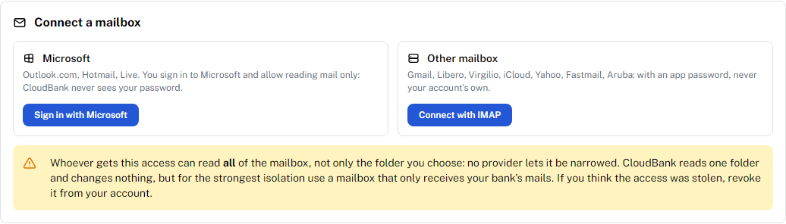
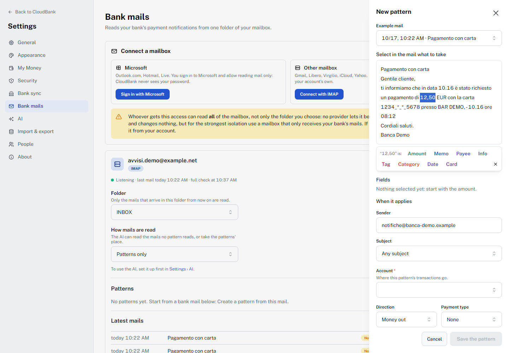
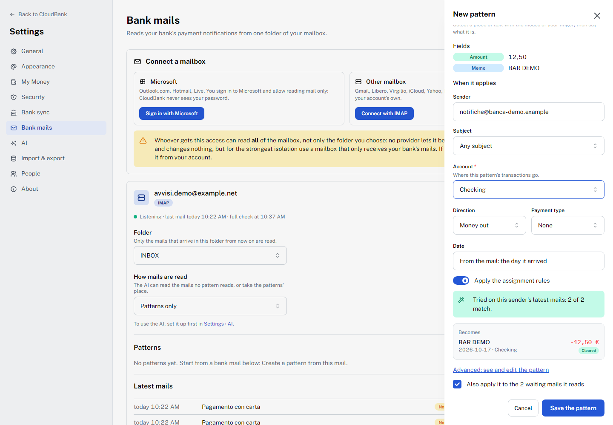
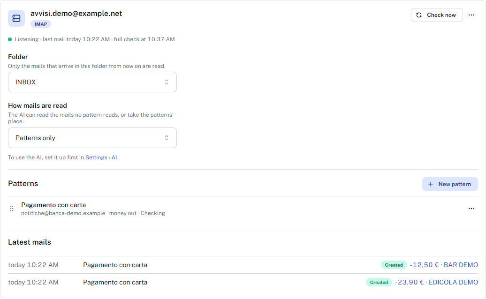
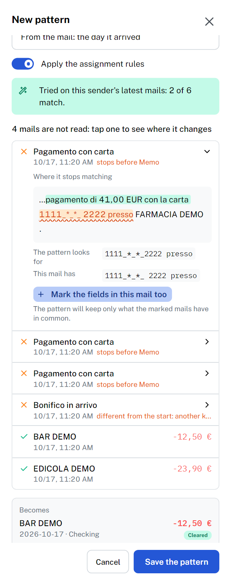
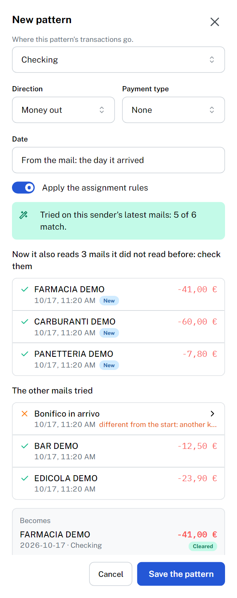
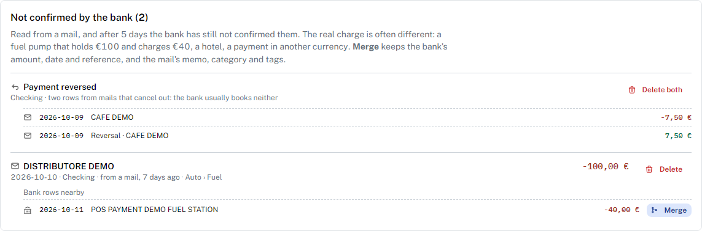

# Bank mails

Most banks send a mail for every card payment, often within a minute of it.
CloudBank can read those notices from one folder of your mailbox and write each
one as a transaction, so the register is up to date long before the bank books
the movement or bank sync brings it. When the bank's own row arrives, through
[bank sync](bank-sync.md), it is merged into the one the mail wrote instead of
being added twice.

It lives in **Settings → Bank mails**, and each mailbox belongs to a wallet. The
[demo](demo.md) has it switched off: it would need your mailbox.

- [Before you start](#before-you-start)
- [A mailbox only for the bank](#a-mailbox-only-for-the-bank)
- [Connecting a mailbox](#connecting-a-mailbox)
- [Patterns: teaching CloudBank a bank's mail](#patterns-teaching-cloudbank-a-banks-mail)
- [Reading mails with the AI](#reading-mails-with-the-ai)
- [When the bank's own row arrives](#when-the-banks-own-row-arrives)
- [Troubleshooting](#troubleshooting)

## Before you start

- **The server needs `CB_SECRET_KEY`.** The mailbox credential (a Microsoft
  sign-in or an app password) is stored encrypted, and without the key the
  section says so and connects nothing. See [Configuration](../README.md#configuration).
- **Only new mails are read.** CloudBank starts at the end of the folder you
  choose: mails already there are never fetched. Once you have connected, wait
  for the next payment, or have the bank send a test notice if it can.
- **Read only.** CloudBank reads one folder and never sends, moves, deletes or
  marks anything as read. It keeps the newest 50 mails of each mailbox, to make
  patterns from and to show their history. Disconnecting forgets the credential
  and those mails; the mailbox itself is untouched.

## A mailbox only for the bank

The access a mail provider gives covers **the whole mailbox**, not one folder:
no provider lets it be narrowed. CloudBank reads only the folder you choose, but
whoever stole that access could read everything. The safest setup is a mailbox
that receives nothing but the bank's notices. Two ways to get one:

1. **Change the address in the bank.** Most banks let you choose where their
   notifications go, in the app or the website's notification or security
   settings. Create a free mailbox (Outlook.com, Gmail, or any provider below)
   and give the bank that address. This is the cleanest option. The mails arrive
   exactly as the bank sent them, so the mail server can still vouch for the
   sender (see [Authenticated senders](#authenticated-senders-only)).
2. **Forward only the bank's mails.** Keep the bank writing to your usual
   address, and add a rule there that sends only the mails from the bank's
   address to the dedicated mailbox. Check two things once the first one
   arrives:
   - **The sender is still the bank's.** A plain forward often puts your own
     address in *From*, and then the pattern's sender never matches. Prefer a
     *redirect* rule (Outlook calls it "Redirect to"), which passes the mail on
     as it came.
   - **It still counts as authenticated.** Forwarding can break the bank's
     signature. If the forwarded mails show as **Not authenticated** in the
     history, either change the address in the bank instead, or turn off
     **Authenticated senders only** in the pattern, knowing what that costs.

If you would rather use your everyday mailbox, choose a folder and let a rule in
your mail client move the bank's notices into it. CloudBank reads that folder
alone.

## Connecting a mailbox



### Outlook.com, Hotmail and Live

Microsoft no longer accepts passwords over IMAP for personal accounts, so these
mailboxes connect by signing in to Microsoft. Your password is never typed into
CloudBank.

1. **Sign in with Microsoft.** CloudBank shows a short code and a link to
   Microsoft's sign-in page, with a QR code for your phone.
2. Open the page, on any device, and enter the code.
3. Sign in with the account that receives the bank's mails, and allow CloudBank
   to **read your mail**. Nothing else is asked for: it cannot send, delete or
   move anything.

The code is valid for a few minutes; **Start again** gets a new one. Microsoft's
permission lasts until you revoke it from your Microsoft account. If it lapses,
the mailbox turns red and **Sign in again** repeats the steps.

This is built for personal Microsoft accounts. A work or school account works
only if its organisation lets its users grant this permission.

### Any other mailbox, with an app password

**Connect with IMAP** asks for the address and an **app password**: a separate
password your provider generates for one program, which you can revoke on its
own without changing your account's password. Your account's own password
usually does not work over IMAP, and CloudBank never asks for it.

CloudBank recognises these providers from the address, fills in their server,
and links their guide to making an app password:

| Provider | App password |
| --- | --- |
| Gmail | [Sign in with app passwords](https://support.google.com/accounts/answer/185833). Needs 2-Step Verification on. Gmail's labels appear as folders. |
| Libero | [Password Sicura](https://aiuto.libero.it/articolo/sicurezza/password-sicura-specifica-applicazioni-client/): a 16-character app password once Password Sicura is on |
| Virgilio | [Password Sicura](https://aiuto.virgilio.it/articolo/sicurezza/password-sicura-specifica-applicazioni-client/), as for Libero |
| iCloud | [App-specific passwords](https://support.apple.com/102654). Needs two-factor authentication on. |
| Yahoo | [Generate an app password](https://help.yahoo.com/kb/SLN15241.html), in the account's security settings |
| Fastmail | [App passwords](https://www.fastmail.help/hc/en-us/articles/360058752854-App-passwords): the account's own password is refused |
| Aruba | No app passwords: the mailbox's own password ([server settings](https://guide.aruba.it/hosting-e-domini/email/configurazione-posta/parametri-configurazione-posta)) |

For any other provider, choose **Another server** and type its IMAP server, port
and encryption (TLS on port 993 is the usual one). The connection is always
encrypted, and the server must be on the public internet. CloudBank signs in
before saving anything, so a wrong password is caught right away. The password is
stored encrypted and never shown again. When you change it at the provider, give
CloudBank the new one from the mailbox's menu.

### The folder, and when mails are read

Choose the **Folder** to read; only mails that arrive in it from then on are
read. Most mailboxes are then **Listening**: the server tells CloudBank the
moment a mail arrives, and a full check every 15 minutes catches anything
missed. A server that cannot announce new mail is checked every 5 minutes
instead. **Check now** reads at once.

If a mailbox stops working (a refused password, an expired Microsoft sign-in),
the mailbox turns red, and the person who connected it is told in the bell, and
by push where it is on (**Settings › Notifications**).

Once a mailbox is connected, the page offers a short tour of its parts; the
**?** beside the section title plays it again.

## Patterns: teaching CloudBank a bank's mail

A **pattern** says how to read one kind of bank mail: where the amount is, what
the description is, and which account the transaction goes to. Nothing comes
built in, because every bank writes its own. You make a pattern from a real mail,
by selecting text in it.

### Making a pattern

Under **Latest mails**, a mail no pattern reads shows **Not recognised**, with
**Create a pattern from this mail**. The first time, the editor offers a short
tour of its parts at its top; the **?** in its header plays it again.



1. **Select the amount** in the mail with the mouse or your finger, then choose
   **Amount**. Every pattern needs one.
2. Select whatever else you want to keep and say what it is: the merchant as
   **Memo** or **Payee**, a reference as **Info**, a **Category** or **Tag** the
   mail names, the **Date** when the mail writes one, the **Card** digits.
3. Check **When it applies**. **Sender** is the mail's sender, and **Subject**
   can narrow the pattern to the mails whose subject contains a word, when one
   sender writes several kinds of mail.
4. Choose the **Account** the transactions go to. The pattern never guesses it.
   Under **Accounts by card**, several cards that share one kind of mail can go
   to different accounts, by their digits.
5. Choose the **Direction**: **Money out**, **Money in**, or **From the mail**,
   when one kind of mail covers both. For that, select the word that tells the
   direction and list the words that mean money in.
6. Choose a **Payment type** if you want one. **Date** is the day the mail
   arrived unless you selected one, and then **Date format** says how it is
   written (`DD.MM`, `DD/MM/YYYY`; without a year, the year the mail arrived).
   **Apply the assignment rules** runs your [rules](pages.md) on every
   transaction, as an import does.



As you go, CloudBank tries the pattern on that sender's latest mails ("2 of 2
match") and shows the transaction the mail becomes. On save, **Also apply it to
the waiting mails it reads** writes the mails that already arrived.

The transactions are written as **Cleared**. In the history, each mail a
pattern read links to its transaction in the register.



### An example

A notice modelled on the card notices of an Italian bank, with an invented
amount, merchant and card:

```text
Gentile cliente,
ti informiamo che in data 10.16 è stato richiesto un pagamento di 12,50 EUR
con la carta 1234_*_*_5678 presso BAR DEMO, - 10.16 ore 08:12
Cordiali saluti.
```

Select `12,50` as **Amount** and `BAR DEMO` as **Memo**, choose the account, and
the pattern reads every notice written like this one. There is no need to select
the card: it changes nothing in the transaction.

### Several patterns, and their order

**The first pattern that reads a mail wins.** Drag the patterns in the list to
change their order: put a narrow one (a subject that contains *Bonifico*) above
a broad one (any mail from the same sender).

### When one pattern does not cover every mail

A bank can send the same notice in more than one wording. The same bank as above
also writes, for some payments:

```text
ti informiamo che in data 16. 10 e' stato effettuato un pagamento di 31,88 EUR
con la carta 1234_*_*_ 5678 presso BIRRERIA DEMO .
```

The card mask has a space, and the merchant ends with ` .` instead of `, -`. A
pattern made from the first mail stops at those differences, and the test says
how many of the sender's mails it reads. Under it, every mail it does not read
is listed: tap one to see **where it stops matching**. The part the pattern read
is green, the text that differs is orange, and below it **The pattern looks
for** and **This mail has** sit side by side, so a single extra space shows.



**Mark the fields in this mail too** adds it to the **Example mails**. Select the
same fields in it (here the amount and the merchant), and the pattern keeps only
what the marked mails have in common: it skips the card, which differs, and
accepts either ending. Add as many example mails as the bank has wordings.



Two things stop a pattern from growing too loose:

- The mails it **now reads that it did not read before** are listed first, as
  **New**, with the amount and memo each one gives. Check them before saving.
- A mail that differs from the very first words is marked as **another kind of
  notice** (a transfer, from the same sender) and offers no button: it needs a
  pattern of its own. If two example mails have nothing in common before a
  field, or have their fields in another order, the editor says so and does not
  merge them.

**Advanced: see and edit the pattern** shows the expression the selections
built: [RE2](https://github.com/google/re2/wiki/Syntax), with one named group per
field, matched against the subject, a new line and the body. For the two
wordings above it is:

```text
pagamento\s+di\s+(?P<amount>\d(?:[\d.,]*\d)?)[\s\S]*?\spresso\s+(?P<memo>.+?)(?:,\s+-|\s+\.)
```

An expression edited by hand stays as written, and the list of mails no longer
says where each one stops; **Back to the selections** returns to the one built
from the mails. RE2 runs in linear time, so a badly written expression cannot
stall the server.

### Authenticated senders only

Anyone can send a mail that claims to come from your bank. To stop a forged
notice from writing a transaction, a pattern reads only mails the receiving
server **authenticated**: their sender's domain passed DMARC, or a DKIM signature
of that domain. Others show as **Not authenticated** in the history and write
nothing. The switch is under **Advanced**. Turn it off only for a bank that does
not sign its mails, or for a forward that breaks the signature.

## Reading mails with the AI

If you have set up an AI provider in **Settings → AI**, a mailbox can have its
mails read by it. **How mails are read** offers four modes:

- **Patterns only**: the default.
- **Patterns first, then the AI**: the AI reads only the mails no pattern reads.
- **The AI first, then the patterns**: the patterns get what the AI did not take
  for a payment.
- **The AI only.**

A mode with the AI asks for three more things:

- **Account.** Where what the AI reads goes. The AI never chooses the account.
- **The description goes in.** Memo or Payee.
- **The bank's senders.** The addresses or domains whose mails may go to the AI.
  It is prefilled from the patterns' senders.

Know what it means before you turn it on:

- **The mail's text leaves your server.** It goes to the AI provider of whoever
  connected the mailbox, as set up in Settings → AI. Only authenticated mails
  from the listed senders are sent, never a mail that is not authenticated.
  Card numbers, IBANs and any other run of eight or more digits are replaced
  first, so they never reach the provider.
- **The AI can be wrong.** It can misread an amount, a date or the direction.
  A date far from the day the mail arrived (more than 31 days before it, or
  later than the day after) is taken as a misreading, and the arrival day is
  used instead.
  An answer that is not a payment leaves the mail **Not recognised**. Check what
  it writes: the history marks those transactions **AI**.
- **It is the connector's provider and quota.** Any member of the wallet can
  change the mode, and the mails then go to the AI set up by the member who
  connected the mailbox.

A pattern costs nothing, runs on your server and reads the same mail the same
way every time. The AI is for the mails you have no pattern for yet.

## When the bank's own row arrives

A transaction from a mail is one the bank has not booked yet. The register marks
it with an envelope until the bank does.

- **Bank sync merges into it.** When [bank sync](bank-sync.md) brings a row with
  the same amount within 7 days, it merges into the mail's transaction, exactly as
  into one you entered by hand: the bank's reference, date and status, and the
  bank's description as the memo. The envelope goes away.
- **The bank booked a different amount.** A fuel pump that holds €100 and
  charges €40, a hotel that adds a city tax, a payment in another currency: the
  amounts differ, so nothing merges. Five days after its date, a mail's
  transaction the bank has not booked shows in [Review](pages.md) under **Not
  confirmed by the bank**:

  

  Each one lists up to three bank rows of the same account within a week, the
  nearest amount first. **Merge** keeps the bank's row, with its amount, date,
  reference and status, and gives it the mail's memo, category, payee and tags.
  **Delete** removes the mail's transaction, for a payment that never happened.
- **A refused card.** Some banks send a payment notice and, a moment later, a
  reversal. If you have a pattern for the reversal (direction **Money in**), the
  two transactions cancel out, and the bank usually books neither. Review shows
  them together as **Payment reversed**, with **Delete both**.

The register's **to review** button counts these too.

## Troubleshooting

- **Nothing arrives.** Check the folder: only mails that arrive in it after you
  connected are read. A rule that files the bank's mails elsewhere, or a spam
  filter, keeps them out of sight.
- **Not recognised.** No pattern reads the mail. Make one from it, or open the
  pattern that should have read it and compare: the test line says how many of
  the latest mails match.
- **Not authenticated.** The receiving server could not vouch for the sender.
  It is usually a forward (see
  [A mailbox only for the bank](#a-mailbox-only-for-the-bank)), sometimes a bank
  that does not sign its mails.
- **The Microsoft sign-in has expired**, or **The mail server refused the app
  password**: **Sign in again**, or give the new app password from the
  mailbox's menu.
- **The same payment twice.** A mail is read once, however often it is fetched.
  A transaction from a mail plus the bank's row with a different amount is
  what Review's **Not confirmed by the bank** is for.

Something missing or wrong? [Open an issue](https://github.com/easly1989/cloudbank/issues/new).
